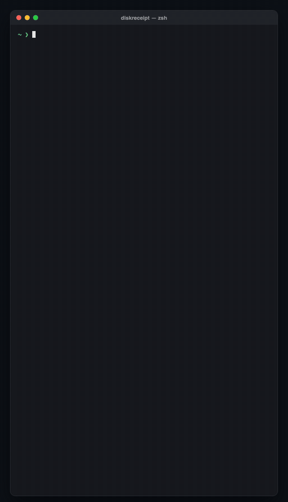

<div align="center">

# 🧾 diskreceipt

**Your Mac never gave you a receipt for its disk space. This prints one.**

One command shows how much space Xcode, `node_modules`, Python `.venv` folders, Docker and every package manager cache take on your Mac. Each line says what's safe to delete and the exact command to do it.

[](https://github.com/abdiraimov-otabek/diskreceipt/releases)
[](https://github.com/abdiraimov-otabek/homebrew-tap)


[](LICENSE)



<sub>A real run on my Mac. Project paths hidden in the spinner, everything else as printed.</sub>

</div>

## Install

```sh
brew install abdiraimov-otabek/tap/diskreceipt
```

Or without Homebrew:

```sh
curl -fsSL https://raw.githubusercontent.com/abdiraimov-otabek/diskreceipt/main/diskreceipt -o /usr/local/bin/diskreceipt
chmod +x /usr/local/bin/diskreceipt
```

It's one Bash script with no dependencies. It runs on the Bash 3.2 that ships with macOS.

## Run it

```sh
diskreceipt
```

That's it. It scans your home folder in about 20 seconds and prints the receipt.

📖 **New here? Read the [step-by-step guide](GUIDE.md):** how to read the receipt, what's safe to clean per tool, keeping a history and troubleshooting.

| Option | What it does |
|---|---|
| `--root ~/code` | Look for projects only in `~/code` |
| `--depth 4` | How deep to look for project folders (default 6) |
| `--no-projects` | Global caches only, done in a couple of seconds |
| `--no-anim` | Print the receipt at once |
| `--no-color` | Plain text (also on when you pipe or redirect, or set `NO_COLOR`) |

## What you get

**A live scan.** The spinner says what it's weighing and keeps a running total, so you know it isn't stuck: `⠹ Weighing node_modules #30  11.5 GB found so far`.

**The receipt.** It prints line by line like a thermal printer. Every item gets a size bar and a label:

| Label | Meaning |
|---|---|
| 🟩 **safe** | A cache. It comes back on its own the next time you build or install. |
| 🟨 **check** | Comes back, but look first. Deleting a `node_modules` or `.venv` you still use costs a reinstall. |
| 🟥 **keep** | Your files. Xcode Archives and Android emulators don't come back. |

**Quick wins.** The three biggest safe items that have an official one-line command, ready to paste:

```
QUICK WINS (safe, paste into Terminal)
  $ uv cache prune                    # 3.4 GB
  $ npm cache npx rm                  # 2.4 GB
  $ npx @puppeteer/browsers clear     # 1.1 GB
  up to 6.8 GB back, and all of it rebuilds on its own
```

**A note from the cashier.** It's based on your biggest item and your total. It isn't useful, but it's honest:

```
                    Cashier's note:
  node_modules: heaviest object in the known universe.
       That's a lot of "I might need this later".
```

## What it checks

| Cache | Where | Clean with |
|---|---|---|
| Xcode DerivedData | `~/Library/Developer/Xcode/DerivedData` | Quit Xcode, move to Trash |
| Xcode DeviceSupport | `~/Library/Developer/Xcode/*DeviceSupport` | Move old OS versions to Trash |
| Xcode Archives | `~/Library/Developer/Xcode/Archives` | Organizer > Archives (**keep**) |
| SwiftUI Previews | `~/Library/Developer/Xcode/UserData/Previews` | Quit Xcode, move to Trash |
| Simulator devices | `~/Library/Developer/CoreSimulator/Devices` | `xcrun simctl delete unavailable` |
| SwiftPM, CocoaPods, Carthage | `~/Library/Caches/…` | `swift package purge-cache`, `pod cache clean --all` |
| Homebrew downloads | `~/Library/Caches/Homebrew` | `brew cleanup` |
| npm, npx, pnpm, Yarn, Bun | `~/.npm`, `~/Library/pnpm/store`, `~/.bun/install/cache` | `npm cache clean --force`, `pnpm store prune`, `yarn cache clean` |
| pip, Poetry, uv | `~/Library/Caches/pip`, `~/.cache/uv` | `pip cache purge`, `uv cache prune` |
| Cargo, Go | `~/.cargo/registry`, `~/Library/Caches/go-build`, `~/go/pkg/mod` | `go clean -cache`, `go clean -modcache` |
| Gradle, Maven | `~/.gradle/caches`, `~/.m2/repository` | Stop daemons, move to Trash |
| Android | `~/Library/Android/sdk/system-images`, `~/.android/avd` | `sdkmanager --uninstall`, `avdmanager delete avd` |
| JetBrains, VS Code | `~/Library/Caches/JetBrains`, `~/Library/Application Support/Code` | Invalidate Caches, or quit and move to Trash |
| Playwright, Puppeteer, Electron | `~/Library/Caches/ms-playwright`, `~/.cache/puppeteer` | `npx playwright uninstall --all` |
| Docker Desktop | `~/Library/Containers/com.docker.docker/…/Docker.raw` | `docker system df`, then `docker image prune -a` |
| `node_modules` | next to a `package.json` | your install command |
| Rust `target/` | next to a `Cargo.toml` | `cargo clean` |
| SwiftPM `.build` | next to a `Package.swift` | `swift package clean` |
| CocoaPods `Pods/` | next to a `Podfile` | `pod install` |
| Python `.venv` | in any project | your install command |

A project folder only counts when the file next to it proves what it is, so a random folder called `target` is ignored. Nested `node_modules` are counted once. Items under 1 MB are left off.

## Is it safe?

Yes. diskreceipt only reads:

- It measures with `du` and finds projects with `find`. Those are the only two tools it runs on your files.
- It never deletes, moves or changes a file. It prints commands, and you decide whether to run them.
- It makes no network calls and collects nothing.
- It's about 260 lines of Bash. You can read all of it in a few minutes, and you should before you `curl` any script.

## FAQ

**Why is "System Data" so big on my Mac?**
macOS files most developer caches under System Data in Settings > General > Storage, so a developer Mac can show 50 to 100 GB there with no explanation. diskreceipt shows where that space actually is.

**How is this different from DaisyDisk, GrandPerspective or `ncdu`?**
Those show you every folder by size. diskreceipt only looks at developer caches, and for each one it tells you whether it comes back and the official command to clean it.

**Is it safe to delete DerivedData / node_modules / the uv cache?**
DerivedData and the package manager caches are labeled **safe**: they rebuild on the next build or install. `node_modules` and `.venv` are **check**: they come back, but only after a reinstall. The receipt prints the right command for each.

**Does it work on Linux?**
No. The paths are macOS paths.

**My cache isn't on the list.**
Each cache is one line in the script: `add "Label" SAFE "command" "path"`. Add yours, run `./test.sh`, and open a PR.

## Want it cleaned, not just counted?

[**Shedi**](https://shedi.app/?ref=diskreceipt) is the Mac app from the same author. It finds the same caches and explains every item. It pre-selects only the safe ones and moves them to the Trash first, so nothing is gone until you empty it. Buying it is also the best way to support this project.

## Development

```sh
./test.sh
```

The test builds a fake home folder with known caches and projects, runs the receipt, and checks the sizes, the labels, quick wins and the cashier's note. It also checks that nothing was deleted.

## License

MIT © Otabek Abdiraimov
